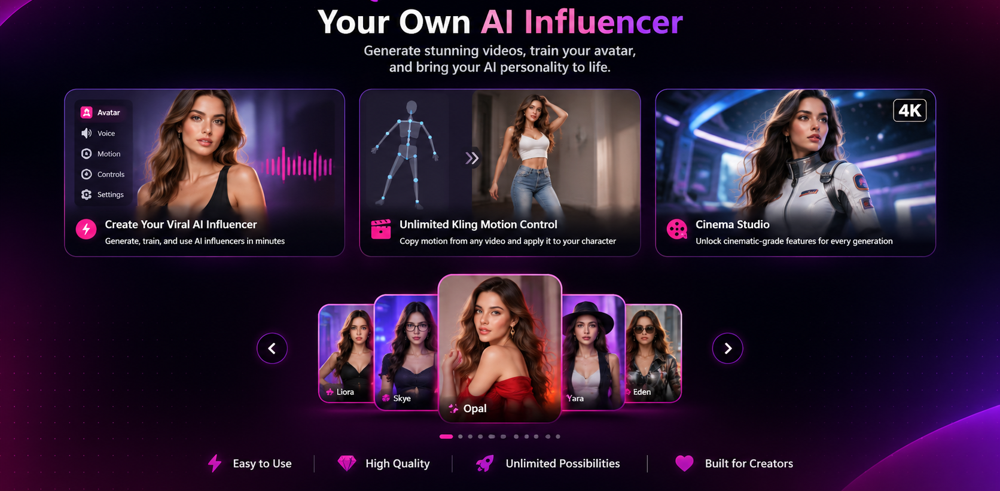
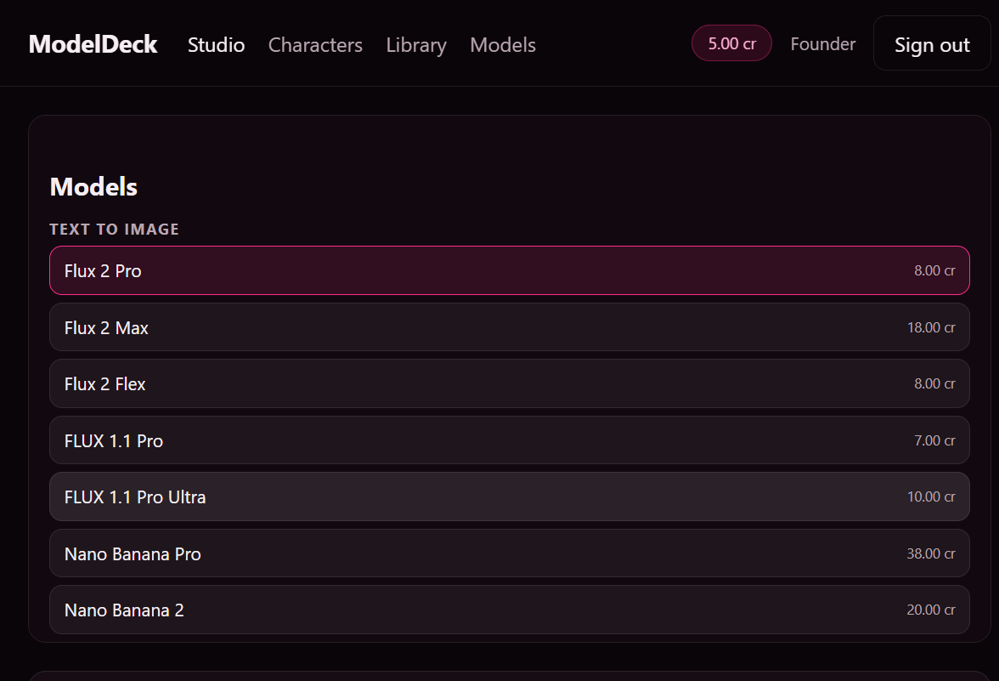
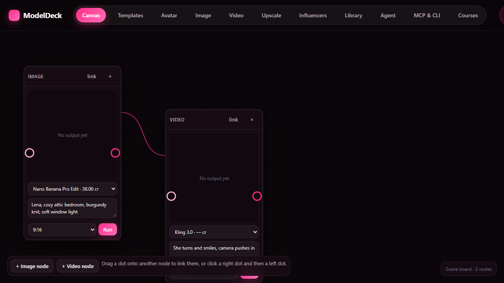
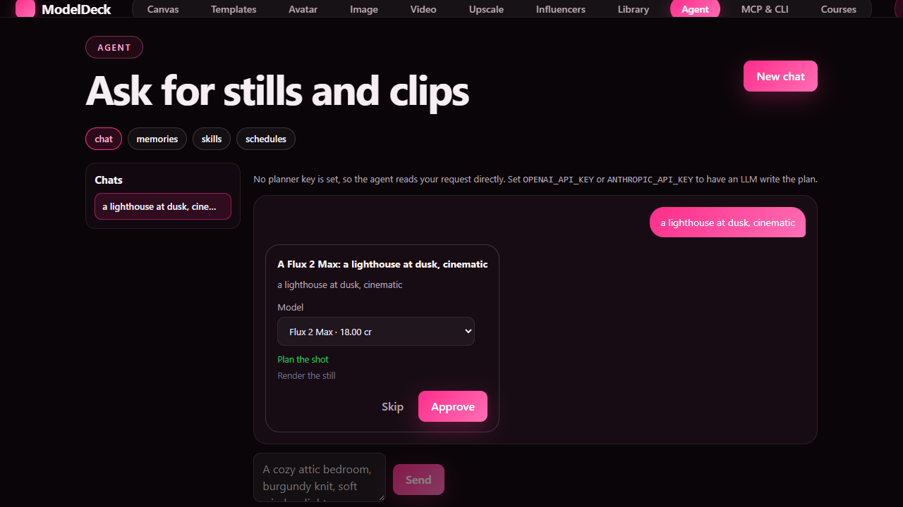
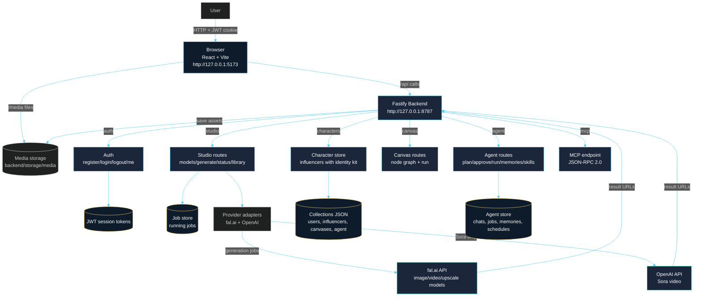

# ModelDeck

[](https://opensource.org/licenses/MIT)
[](https://github.com/patilakshay111/Project-self-healing-docs-with-PR/releases/latest)
[](https://github.com/marketplace)
[](https://opensource.org/licenses/MIT)
[](https://www.python.org/)
[](https://platform.openai.com/)
[](https://www.docker.com/)
[](https://github.com/features/actions)
[](CONTRIBUTING.md)

An AI model studio: one prompt bar across image, video and upscaling models,
with characters you can reuse across every model, a node-graph canvas, and an
MCP endpoint so an assistant can drive it.

The point of this project is the **cost model**. It talks to the model
providers directly — fal.ai and OpenAI — and there is no subscription or
credit pack in between. What a run costs is what the provider charges.






---

## What's in it

| Feature | Where |
|---|---|
| Studio — image and video tabs, model picker with live prices, prompt bar, reference images | `frontend/src/pages/Studio.tsx` |
| **Ready-made looks** — 98 characters you can claim in one click | `frontend/src/pages/TemplatesPage.tsx` |
| **Canvas** — a node graph; wire one node's output into the next as its reference image | `frontend/src/components/CanvasEditor.tsx` |
| **Agent** — you write it, an LLM plans it, you approve it, it runs | `frontend/src/pages/AgentPage.tsx` |
| Characters — your own cast, reusable across every model | `frontend/src/pages/InfluencersPage.tsx` |
| Library, model catalogue, MCP | `frontend/src/pages/` |
| 50 models, 2 provider adapters, credit ledger | `backend/src/` |

---

## Layout

```
modeldeck/
  backend/            Fastify + TypeScript API
  frontend/           React + Vite studio
  docs/               API contract, model registry, feature map, assets
```

---

## Architecture



### Data flow

1. **Browser** sends authenticated API calls (JWT in `modeldeck:token`) to the
   Fastify backend on port 8787.
2. **Backend** authenticates the session, then routes to the appropriate domain
   (studio, characters, canvas, agent, MCP).
3. **Studio generation** sends prompts + reference images to provider adapters
   (fal.ai / OpenAI), which return media URLs.
4. **Media** is saved to `backend/storage/media/` and served back to the browser
   via `/media`.
5. **Canvas** stores node graphs as JSON; running a node submits it through the
   same studio generate path.
6. **Agent** plans jobs via an LLM planner (OpenAI/Anthropic), waits for
   approval, then runs them through the studio.
7. **MCP** exposes `list_models`, `list_avatars`, `generate`, `job_status`,
   `credit_balance` over JSON-RPC 2.0.

### Stores (all JSON files, recreated on first boot)

| File | Holds |
|---|---|
| `backend/data/users.json` | accounts, password hashes, credit balances |
| `backend/data/collections.json` | influencers (identity kits) |
| `backend/data/canvases.json` | saved node-graph canvases |
| `backend/data/agent.json` | agent chats, jobs, memories, schedules |

---

## Running it

### Prerequisites

- Node.js 22.19+, 24.11+ or 26+ (this machine has 24.18.0 at
  `C:\Users\Akshay\.local\node\node-v24.18.0-win-x64`)
- A fal.ai key for most models, and an OpenAI key for Sora

### Windows — one-click start

Double-click **`start-modeldeck.bat`** at the repository root. It:

1. Stops any old backend (port 8787) / frontend (port 5173) processes
2. Starts the backend in a new terminal window
3. Starts the frontend in a new terminal window
4. Keeps both terminals open — `Ctrl+C` in either window closes that service

To stop everything at once, double-click **`stop-modeldeck.bat`**.

Backend: `http://127.0.0.1:8787`
Frontend: `http://127.0.0.1:5173`

Dev seed account: `founder@modeldeck.test` / `modeldeck-dev-pass-1`

### Manual start (terminal)

### Backend

```powershell
cd backend
copy .env.example .env        # then paste your fal.ai key into FAL_KEY
npm install
npm run dev                   # http://127.0.0.1:8787
```

### Frontend

```powershell
cd frontend
npm install
npm run dev          # http://127.0.0.1:5173
```

The Vite dev server proxies `/api` and `/media` to the backend, so the browser
talks to one origin and no CORS setup is needed in development.

### Stopping it

Both servers run in their own terminal windows. Stop each one where it is running:

**In each terminal:**
- `Ctrl+C` — stops that server cleanly

**From PowerShell (if the window was closed or you want to kill by port):**

```powershell
# Stop the backend (port 8787)
Get-NetTCPConnection -LocalPort 8787 -State Listen -ErrorAction SilentlyContinue |
  ForEach-Object { Stop-Process -Id $_.OwningProcess -Force }

# Stop the frontend (port 5173)
Get-NetTCPConnection -LocalPort 5173 -State Listen -ErrorAction SilentlyContinue |
  ForEach-Object { Stop-Process -Id $_.OwningProcess -Force }
```

Or stop all `node` processes for this project:

```powershell
Get-Process node -ErrorAction SilentlyContinue |
  Where-Object { $_.MainWindowTitle -or $_.Path -match 'modeldeck' } |
  Stop-Process -Force
```

`backend/.env` is read at boot.

Keys:

| Variable | Where to get it |
|---|---|
| `FAL_KEY` | <https://fal.ai/dashboard/keys> — almost every model runs through it |
| `OPENAI_API_KEY` | <https://platform.openai.com/api-keys> — Sora only; fal.ai does not host Sora |
| `JWT_SECRET` | any long random string |
| `ENABLE_SPICY_MODELS` | set to `1` to show uncensored / spicy models (hidden otherwise) |

Check they were picked up:

```powershell
curl http://127.0.0.1:8787/api/health
# {"ok":true,"providers":{"fal":true,"openai":true}}
```

### Frontend

```powershell
cd frontend
npm install
npm run dev          # http://127.0.0.1:5173
```

The Vite dev server proxies `/api` and `/media` to the backend, so the browser
talks to one origin and no CORS setup is needed in development.

### Checks

```powershell
cd backend
npm run typecheck
node scripts/smoke.mjs                       # 38 checks against a running backend
node --import tsx scripts/generate-model-docs.mjs ../docs/MODEL-REGISTRY.md
```

---

## Configuration

| Variable | Required | Meaning |
|---|---|---|
| `PORT` / `HOST` | no | Listen address. Defaults to `127.0.0.1:8787`. |
| `PUBLIC_ORIGIN` | in production | The origin media URLs are built from. |
| `JWT_SECRET` | in production | Session token signing key. At least 16 characters. |
| `FAL_KEY` | for fal models | fal.ai API key. |
| `OPENAI_API_KEY` | for Sora | OpenAI API key. Sora is not on fal.ai. |
| `STORAGE_DIR` | no | Where media and account data live. Defaults to `./storage`. |
| `CORS_ORIGINS` | no | Comma-separated allowed origins. |
| `JOB_TIMEOUT_MS` | no | Ceiling on one generation job. Default 15 minutes. |

A provider with no key is not a startup failure. The service starts, reports
the provider as unconfigured, and refuses work that needs it with
`503 provider_unavailable`.

---

## The agent

ModelDeck has a **plan, approve, run** pipeline:

1. you write what you want in a chat
2. an LLM turns it into a plan — which model, what prompt, how long
3. the plan comes back for approval, with the model and duration editable
4. you approve it and it runs
5. the outputs land back in the chat

Around it sit **memories** (facts the agent keeps and puts into every plan),
**skills** (what it can do), **schedules** (recurring jobs) and **connectors**.

The planner uses `OPENAI_API_KEY` or `ANTHROPIC_API_KEY`. With no LLM key it
falls back to reading the request directly, so the pipeline still works with
only a fal key.

All 21 agent endpoints exist here. See `docs/AUDIT.md`.

---

## How the money works

Three separate numbers:

| | |
|---|---|
| **Provider cost** | What fal.ai or OpenAI charges for the call. This is the real cost. |
| **Credits** | This service's unit: `provider USD × 250` for an image, `× 320` for a second of video. |
| **Credit price** | What one credit sells for. **The only number that sets your markup.** |

`CREDIT_PRICE_USD` (default `0.004`) is that number:

| `CREDIT_PRICE_USD` | Image markup | Video markup |
|---|---|---|
| 0.004 (default) | **1.00×** | **1.28×** |
| 0.0165 | 4.13× | 5.28× |
| 0.058 | 14.5× | 18.6× |

fal bills **dollars**, not a separate credit unit, and never charges for
server errors. Every model in the catalogue shows its provider cost up front.

See `docs/MODEL-REGISTRY.md` for every model, its upstream id and its price.

---

## The canvas

A canvas is a saved node graph. Each node is one generation step: a model, a
prompt, and the settings for one run. Wire a node's output into another node
and it becomes that node's reference image — so a character chains into a
scene, and a scene chains into a video.

**Linking** works four ways, so it is never fiddly:

| How | What you do |
|---|---|
| Drag | Press a node's **right** dot, drag onto the node that should consume it |
| Drag back | Press a node's **left** dot, drag onto the source node |
| Click | Click a right dot, then a left dot |
| Button | Click `link` in a node's header, then pick a source |

The drop target is the whole node, not just the dot. Press-and-move is a
drag; press-and-release is a click.

| Route | What it does |
|---|---|
| `GET /api/studio/canvases` | Your canvases |
| `POST /api/studio/canvases` | Create one |
| `GET /api/studio/canvases/:id` | One canvas |
| `PATCH /api/studio/canvases/:id` | Rename, or save its nodes |
| `DELETE /api/studio/canvases/:id` | Delete |
| `POST /api/studio/canvases/:id/run` | Run one node |
| `GET /api/studio/canvases/:id/node/:nodeId` | Read a node's result |

---

## Ready-made looks

98 curated characters live in `backend/data/character-templates.json`. Claiming
one from the Templates tab adds it to your characters, where it becomes the
reference image for any generation.

> **Note:** These are placeholder avatars and images included in the repo.
> Real character avatars and template images are generated once users start
> creating their own generations through the studio. Point
> `character-templates.json` at your own images before serving real users.

That file is data, not code — point it at your own bucket to serve your own
looks. See `docs/ASSETS.md`, which also covers the landing images and the
trademarks in the catalogue.

---

## Adding a model

1. Add an entry to `MODELS` in `backend/src/models/registry.ts`: the provider,
   the provider's own upstream id, the provider's USD price, and a
   `buildInput` that translates the canonical request into that provider's
   request body.
2. `npm run typecheck`, then `node scripts/smoke.mjs`.
3. Regenerate `docs/MODEL-REGISTRY.md`.

The studio picks it up with no other change.

---

## MCP

`POST /api/mcp`, JSON-RPC 2.0, same bearer token as the rest of the API.

```json
{
  "jsonrpc": "2.0",
  "id": 1,
  "method": "tools/call",
  "params": {
    "name": "generate",
    "arguments": { "modelKey": "flux-2-max", "prompt": "a lighthouse at dusk" }
  }
}
```

Tools: `list_models`, `list_avatars`, `generate`, `job_status`,
`credit_balance`.

---

## Contributing

ModelDeck is open source and we welcome contributions. See
[CONTRIBUTING.md](CONTRIBUTING.md) for how to get started, how to run the
project locally, how to open pull requests, and our commit style.

Please read our [Code of Conduct](CODE_OF_CONDUCT.md) before participating.

## Security

See [SECURITY.md](SECURITY.md) for how to report vulnerabilities.

## License

ModelDeck is licensed under the [MIT License](LICENSE).

